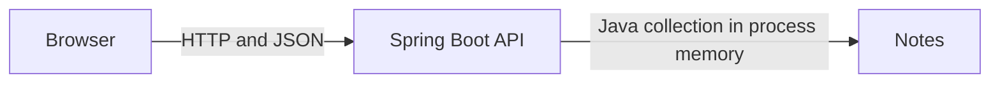
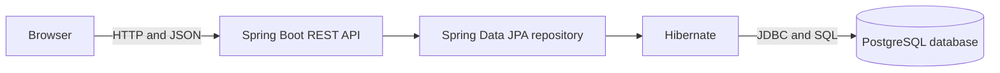
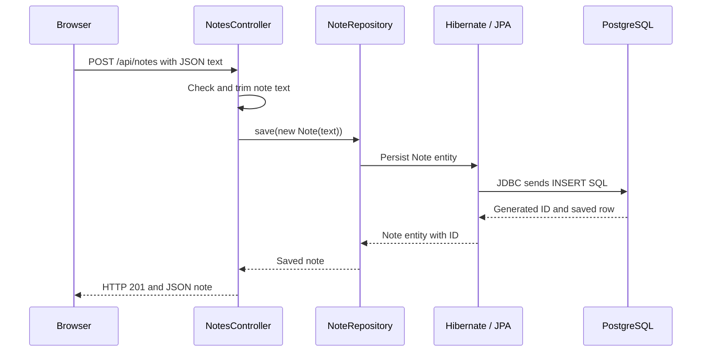

# SE-Lab — Lab 04: Why Do We Need a Database?

Lab 04 replaces Lab 03's temporary Java collection with PostgreSQL. The Notes App can now keep notes when Spring Boot restarts, because the database stores them separately from the application process.

Start with the [SE-Lab learning path](./labs/README.md). Previous implementations are preserved as runnable projects:

- [Lab 01 — JavaScript memory](./labs/01-memory/)
- [Lab 02 — Browser `localStorage`](./labs/02-localstorage/)
- [Lab 03 — Spring Boot backend with in-memory notes](./labs/03-backend/)
- **Lab 04 — Current PostgreSQL-backed app** (this folder)
- [Lab 05 — Git, automated testing, and regression debugging](./labs/05-git-testing/)
- [Lab 06 — Docker and reproducible environments](./labs/06-docker/)
- [Lab 07 — Continuous Integration with GitHub Actions](./labs/07-ci/)

## The problem: application memory is temporary

In Lab 03, notes lived in a Java collection inside Spring Boot. A Java collection is part of the application's process memory: when that process stops, its objects disappear. Starting the same application again creates a new, empty collection.

A **database** is a separate program that organizes and stores data. PostgreSQL writes its database data to persistent storage, so the data can outlive one Spring Boot process. The backend can ask the database to save, find, and delete notes.

## Architecture before and after

**Lab 03:** the backend itself held all notes in memory.



**Lab 04:** PostgreSQL owns the stored notes; the frontend still communicates only with the API.



### What each part does

- **Frontend:** the HTML and JavaScript shown in the browser. It sends API requests; it does not connect to PostgreSQL.
- **Backend:** the Spring Boot application. It receives HTTP requests, checks the input, and coordinates note operations.
- **Database:** PostgreSQL, a separate server process that stores and returns records.
- **Persistent storage:** the database server's files on disk. The database manages these files; the application should not edit them directly.

### SQL, tables, rows, and columns

**SQL** (Structured Query Language) is used to ask a relational database to create, read, update, and delete data. A **table** organizes records of one kind. In the `notes` table, each **row** is one note, and each **column** is one value recorded for every note:

| id | text |
| --- | --- |
| 1 | Learn REST |

The `id` is a database-generated numeric primary key. `text` is a non-null PostgreSQL `TEXT` column.

### JDBC, JPA, Hibernate, Spring Data JPA, entity, and repository

These names describe connected layers, not separate databases:

1. **JDBC** (Java Database Connectivity) is Java's low-level standard for connecting to a database and sending SQL. The PostgreSQL JDBC driver implements that connection for PostgreSQL.
2. **JPA** (Jakarta Persistence API) is a Java standard that describes how Java objects relate to relational data. JPA is a specification, not the database and not itself the implementation.
3. **Hibernate** is the JPA implementation used by this project. It turns operations on Java entities into SQL and maps returned rows back to Java objects, using JDBC to communicate with PostgreSQL.
4. **Spring Data JPA** builds on JPA and provides the repository API. Extending `JpaRepository` gives this small app common operations such as `save`, `findAll`, and `deleteById` without writing that SQL by hand.
5. A JPA **entity** is a Java class mapped to a database table. `Note` maps to the `notes` table.
6. A **repository** is the interface through which the controller asks Spring Data JPA to read and write entities. `NoteRepository` extends `JpaRepository<Note, Long>`.

### What happens for a request

For example, when the browser creates a note:



The `GET` route reads rows through `findAll`, and the `DELETE` route removes the row with the requested ID. The frontend continues to call the same REST endpoints as Lab 03.

## PostgreSQL setup on Windows

### Prerequisites

- Java 17 or newer
- Apache Maven 3.6.3 or newer
- PostgreSQL 14 or newer
- Python 3 (to serve the frontend)

Check Java and Maven in PowerShell:

```powershell
java -version
mvn -version
```

### Install and start PostgreSQL

1. Download and run the PostgreSQL Windows installer from [postgresql.org/download/windows](https://www.postgresql.org/download/windows/).
2. During installation, note the password you set for the PostgreSQL administrator account `postgres`. Keep it private; do not put it in project files.
3. Keep the default port `5432` unless it is already in use. The installer normally creates and starts a Windows service such as `postgresql-x64-18`.
4. Check the service in **Services** (`services.msc`) or pgAdmin. To inspect it in PowerShell, run:

   ```powershell
   Get-Service *postgres*
   ```

   If the installed service is stopped, start the service by its actual name in an elevated PowerShell, for example:

   ```powershell
   Start-Service postgresql-x64-18
   ```

   Replace the example service name with the name installed on your machine.

5. Open a terminal and connect with the `psql` command-line client (installed with PostgreSQL):

   ```powershell
   psql -U postgres -h localhost -d postgres
   ```

   Enter the administrator password when prompted. If PowerShell cannot find `psql`, run it using its installed path, for example `& 'C:\Program Files\PostgreSQL\18\bin\psql.exe' -U postgres -h localhost -d postgres`, adjusting the version folder if needed.

### Create a local database and login

At the `psql` prompt, create a dedicated account. The interactive `\password` command avoids writing the password in SQL or shell history:

```sql
CREATE ROLE selab WITH LOGIN;
\password selab
CREATE DATABASE selab_notes OWNER selab;
\q
```

Choose a local development password at the prompt and remember it for this session. If you already created the role or database, do not run the `CREATE` statements again; connect to the existing database and role instead.

### Connection configuration is not schema creation

Connection configuration tells Spring Boot **where** PostgreSQL is, **which username** to connect as, and **which password** to use. The backend reads these environment variables:

| Variable | Local default | Meaning |
| --- | --- | --- |
| `DB_HOST` | `localhost` | Database server name |
| `DB_PORT` | `5432` | PostgreSQL port |
| `DB_NAME` | `selab_notes` | Database name |
| `DB_USERNAME` | `selab` | Local database login |
| `DB_PASSWORD` | No default; required | Password for that login |

The connection URL is assembled from `DB_HOST`, `DB_PORT`, and `DB_NAME`; the defaults are safe local examples in `backend/src/main/resources/application.properties`. No password is stored in source control. In the same PowerShell window that will run the backend, set:

```powershell
$env:DB_HOST = "localhost"
$env:DB_PORT = "5432"
$env:DB_NAME = "selab_notes"
$env:DB_USERNAME = "selab"
$env:DB_PASSWORD = Read-Host "Enter the local PostgreSQL password for selab"
```

These environment variables configure a connection; they do not create the database or the notes table. The database itself was created above. For this learning project, Hibernate's local-development `spring.jpa.hibernate.ddl-auto=update` setting creates the `notes` table from the entity mapping and updates it when the mapping changes. It does not create the database or insert sample notes. `update` is convenient for this local lab, but a production application should use reviewed, versioned schema migrations instead. Do not point this development schema strategy at important production data.

Never commit real passwords, add them to source files, or paste them into shared logs or screenshots. Use the local defaults only with your own local PostgreSQL instance.

## Run the application

Start PostgreSQL first. Use two PowerShell terminals, both opened at the repository folder `Understand-System`.

**Terminal 1 — configure the connection and run Spring Boot:**

```powershell
$env:DB_HOST = "localhost"
$env:DB_PORT = "5432"
$env:DB_NAME = "selab_notes"
$env:DB_USERNAME = "selab"
$env:DB_PASSWORD = Read-Host "Enter the local PostgreSQL password for selab"
Set-Location .\backend
mvn spring-boot:run
```

The API listens at `http://localhost:8080`. Watch the backend terminal for the successful startup message. On first startup, Hibernate creates the `notes` table inside the existing `selab_notes` database.

**Terminal 2 — serve the browser frontend from the repository folder:**

```powershell
python -m http.server 5500
```

Open `http://localhost:5500` in your browser. The API accepts the exact local frontend origin `http://localhost:5500`; do not substitute `127.0.0.1` or another port. Stop each process with Ctrl+C in its terminal.

## API examples

Create a note:

```http
POST http://localhost:8080/api/notes
Content-Type: application/json

{"text":"Learn REST"}
```

Successful response, with an ID generated by PostgreSQL:

```http
HTTP/1.1 201
Content-Type: application/json

{"id":1,"text":"Learn REST"}
```

Retrieve all notes:

```http
GET http://localhost:8080/api/notes
```

```http
HTTP/1.1 200
Content-Type: application/json

[{"id":1,"text":"Learn REST"}]
```

Delete a note (replace `1` with the ID you received):

```http
DELETE http://localhost:8080/api/notes/1
```

Successful response: `HTTP/1.1 204 No Content`. An empty list is returned as `[]`. Submitting missing, blank, or whitespace-only note text returns `HTTP 400 Bad Request`.

Try the API directly from PowerShell:

```powershell
Invoke-RestMethod -Method Post -Uri http://localhost:8080/api/notes -ContentType 'application/json' -Body '{"text":"Learn REST"}'
Invoke-RestMethod -Method Get -Uri http://localhost:8080/api/notes
Invoke-RestMethod -Method Delete -Uri http://localhost:8080/api/notes/1
```

## Inspect PostgreSQL records with SQL

From another PowerShell window, connect as the lab user:

```powershell
psql -U selab -h localhost -d selab_notes
```

Enter the password when prompted. At the `psql` prompt:

```sql
\d notes
SELECT id, text FROM notes ORDER BY id;
SELECT COUNT(*) FROM notes;
SELECT id, text FROM notes WHERE id = 1;
\q
```

Use the actual ID of your note in the last query. `\d notes` is a `psql` inspection command; the `SELECT` statements are SQL.

## Practical failure experiments

### Experiment A — Restart the application

**Objective:** Observe that application memory and database storage have different lifetimes.

**Steps:** Start PostgreSQL and Spring Boot as described above. Create several notes. Stop only Spring Boot with Ctrl+C. Start it again in the same terminal with `mvn spring-boot:run`, keeping the environment variables set. Request `GET http://localhost:8080/api/notes` or reload the frontend.

**Expected result:** The notes are still returned because PostgreSQL stored them outside the Spring Boot process.

**Why and how to debug:** The new Spring Boot process reconnects to the same database. If notes do not load, check the API response, the backend startup logs, the database service status, and that `DB_HOST`, `DB_PORT`, and `DB_NAME` still point to `selab_notes`.

### Experiment B — Inspect records in PostgreSQL

**Objective:** Confirm that a note created through the app exists as a database row.

**Steps:** Create a note in the frontend. Connect with `psql -U selab -h localhost -d selab_notes`, then run `SELECT id, text FROM notes ORDER BY id;`.

**Expected result:** The SQL result includes the note text and its generated ID.

**Why and how to debug:** The browser sends JSON to Spring Boot; the repository saves the mapped entity, and Hibernate issues SQL to PostgreSQL. If the row is missing, check that you connected to the same database named in `DB_NAME`, then inspect the backend logs and query `\d notes`.

### Experiment C — Make PostgreSQL unavailable

**Objective:** See what fails when the API cannot reach its database.

**Steps:** Stop the PostgreSQL Windows service from Services or pgAdmin; use the actual installed service name if working from PowerShell. Leave Spring Boot running. Send a `GET` request to `http://localhost:8080/api/notes` with `Invoke-RestMethod` or the browser, and inspect the Spring Boot terminal.

**Expected result:** The request fails because the application cannot get a database connection. The exact HTTP response depends on Spring's error handling, the type of database failure, and connection-pool state; it may be an HTTP 5xx response. The frontend displays an error instead of pretending the operation succeeded.

**Why and how to debug:** The HTTP connection to Spring Boot is separate from the JDBC connection from Spring Boot to PostgreSQL. Inspect the response status, backend logs, PostgreSQL service status, port, and configured URL. Do not share logs or screenshots containing credentials.

### Experiment D — Restore PostgreSQL

**Objective:** Recover the database connection without losing saved records.

**Steps:** Start the same PostgreSQL service again. Confirm `Get-Service *postgres*` reports it running, then retry `GET http://localhost:8080/api/notes`. If the existing app does not reconnect, restart Spring Boot with the same environment variables and retry.

**Expected result:** The request succeeds and previously saved notes remain available.

**Why and how to debug:** Connection pools generally discard failed connections and try to establish new ones, but reconnection timing and behavior can vary. Check the service and application logs; restart the app only if the connection does not recover.

### Experiment E — Application, server, and storage lifetimes

**Objective:** Distinguish stopping a program from deleting persistent data.

**Steps:** Compare restarting Spring Boot (Experiment A) with restarting PostgreSQL (Experiments C and D). If you want to observe a destructive change, use a separate disposable practice database and follow the warning below.

**Expected result:** Restarting Spring Boot or PostgreSQL does not by itself delete database rows. Dropping the `notes` table removes the table and its rows. Deleting a database removes everything stored in that database. Removing PostgreSQL's underlying data directory can destroy multiple databases and must not be used as a casual experiment.

**Why and how to debug:** Application memory belongs to the Spring Boot process; persistent rows belong to the PostgreSQL database and its managed files. Do not drop tables, databases, or data directories that contain information you care about. If practicing deletion, create a separate disposable database first, verify its name before deletion, and never use your regular database for the destructive experiment.

## Common errors and how to investigate

| Symptom | Likely cause | What to check |
| --- | --- | --- |
| `mvn` is not recognized | Maven is not installed or not on `PATH` | Install Apache Maven, open a new terminal, and check `mvn -version`. |
| `psql` is not recognized | PostgreSQL command-line tools are not on `PATH` | Run `psql.exe` from the PostgreSQL `bin` folder, or add that folder to your user `PATH`. |
| Spring Boot cannot bind port `8080` | Another application is already listening on the API port | Run `Get-NetTCPConnection -LocalPort 8080 -State Listen` and inspect its `OwningProcess` with `Get-Process -Id <PID>`. Stop it only if it is a process you own and recognize; the frontend expects the API at port `8080`. |
| Connection refused / timeout | PostgreSQL is stopped, the port is wrong, or the server is listening elsewhere | Check the PostgreSQL service, `DB_HOST`, and `DB_PORT`. |
| Password authentication failed | Wrong password, username, or PostgreSQL authentication configuration | Re-enter the password for role `selab`; reset it interactively with `\password selab` as an administrator if needed. |
| Database `selab_notes` does not exist | The database setup step was skipped or used another name | Connect as administrator and verify the database exists; create it as shown above. |
| Spring cannot resolve `DB_PASSWORD` | The password environment variable is missing in this terminal | Set `$env:DB_PASSWORD` in the same PowerShell window before starting Spring Boot or Maven. |
| `relation "notes" does not exist` | The app has not successfully initialized the schema, or the request/test connected to a different database | Check the application startup logs, `DB_NAME`, and `\d` in `psql`; restart the app after PostgreSQL is available. |
| Browser CORS or network error | Frontend URL differs from the configured origin, or backend is unavailable | Use exactly `http://localhost:5500`; inspect DevTools Network and the backend terminal. |
| API returns HTTP 400 for create | The request JSON is malformed or `text` is blank | Send JSON such as `{"text":"Learn REST"}` with `Content-Type: application/json`. |

Spring Boot logs database connection and SQL errors in its terminal. API clients receive an error response, not database credentials. Inspect status codes and server logs locally; do not expose credentials or stack traces in screenshots or shared messages.

## Automated tests

These are PostgreSQL integration tests, not database-free unit tests. A running PostgreSQL server, the `selab_notes` database, and valid credentials are required; Maven will fail during Spring startup if the database is unavailable. Tests use the same `DB_HOST`, `DB_PORT`, `DB_NAME`, `DB_USERNAME`, and `DB_PASSWORD` variables as the app. They do not silently switch to an in-memory database.

From the repository folder in PowerShell, set the three environment variables using the commands in [Connection configuration](#connection-configuration-is-not-schema-creation), then run:

```powershell
Set-Location .\backend
mvn test
```

The API integration tests create a note, retrieve it, delete it, check invalid blank text, and verify the configured CORS origin. They delete the note they create and do not clear existing database rows. A local run during this lab work passed: **2 tests, 0 failures, 0 errors** against a disposable PostgreSQL 18.6 cluster using Java 21. Re-run the command above to verify your own setup.

## Interview explanation

**Why does an application need a database?** Application memory is temporary and tied to one running process. A database provides organized, persistent storage that can be read and updated independently of application restarts. In this Notes App, PostgreSQL stores each note as a row, while the Spring Boot API validates requests and uses Spring Data JPA/Hibernate over JDBC to read and write those rows.

## What you learned and what comes next

You have practiced persistent storage, relational tables and rows, SQL inspection, database connections, JDBC, JPA, Hibernate, Spring Data JPA, entity/repository mapping, API integration tests, and debugging a failed database connection.

Before continuing to [Lab 05 — Git, automated testing, and regression debugging](./labs/05-git-testing/), make sure you can start PostgreSQL and Spring Boot separately, explain why notes survive an application restart, and inspect them with SQL. This lab does not add Docker, authentication, caching, or later deployment technologies.
