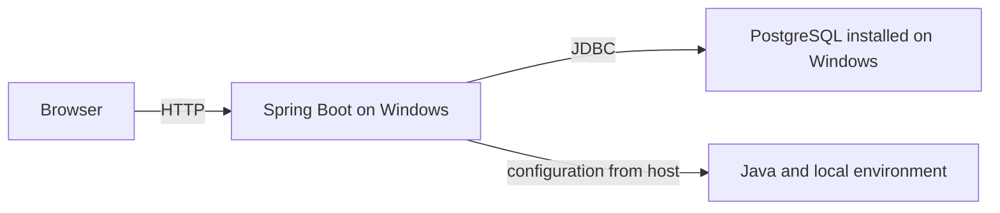
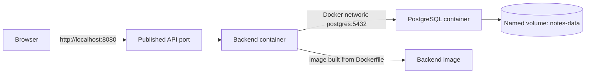

# Lab 06 — Docker and Reproducible Environments

This lab packages the existing Spring Boot Notes API and PostgreSQL database into Docker containers. The API contract, schema, and browser app remain the same. The goal is to see which environment settings containers make repeatable—and which data still needs persistent storage.

## Learning objectives

By the end, you can:

- Explain why software that works on one computer may fail on another.
- Distinguish an image from a container, a Dockerfile from an image, and a build stage from runtime.
- Build and inspect a backend image.
- Run PostgreSQL and Spring Boot on a Docker network using service names.
- Diagnose why `localhost` inside a container is not the Windows host or another container.
- Preserve PostgreSQL records in a named volume when containers are replaced.
- Use environment variables for configuration without committing local credentials.

## Prerequisites

- Windows 10/11 and PowerShell.
- Docker Desktop installed and running with its Linux container engine.
- Git (useful for inspecting the learning project; no Git changes are required).
- Python 3 to serve the existing browser frontend.
- Java 17+ and Maven if you also want to run the backend or its tests directly on Windows.

Check Docker Desktop before continuing:

```powershell
docker --version
docker info
docker compose version
```

`docker info` should show both Client and Server details. If it reports that it cannot connect to the daemon, start Docker Desktop and wait for its engine to finish starting.

## 1. Why environments differ

An **environment** is the combination of operating system, runtime, installed libraries, configuration, and services that a program uses. One computer might have Java 17 and PostgreSQL on port 5432; another might have a different Java version, no database, or a different port. Local environment variables and files can also differ.

Installing every required tool by hand on every computer is easy to get wrong. For this app, the browser needs an API at port 8080, Spring Boot needs Java and PostgreSQL, and PostgreSQL needs credentials plus storage. Docker describes the app's build and runtime environment as files and image configuration so another machine can recreate a similar setup.

**Reproducibility** means that another person can follow the same instructions and get the same intended setup. Docker helps package software and its operating-system dependencies, and Compose can describe multiple services. Docker does not guarantee identical hardware, host settings, external network access, persistent backups, or safe production configuration. A container is not a backup.

### Architecture before and after

Before Docker, install and start each tool separately:



After this lab, the browser still runs on the host, while Compose runs the API and database in separate containers:



The browser is not a container here. The browser sends requests to `http://localhost:8080`, a port published on Windows. From the backend container, PostgreSQL is reached as `postgres:5432`, the Compose service name and its internal port.

## 2. Docker building blocks

- An **image** is a read-only package containing application files and instructions for running them. A **container** is a running (or stopped) instance created from an image.
- A **Dockerfile** is a recipe for building an image. Editing a Dockerfile does not change an image already built from it.
- **Build time** is when Docker reads the Dockerfile and assembles an image. **Runtime** is when a container starts from that image and receives its configuration.
- A container has a writable filesystem for its lifetime. Removing the container removes that writable layer. A **volume** stores data separately, so a replacement database container can use the same stored records.
- The **host** is this Windows computer. The container is an isolated environment managed by Docker Desktop.
- A container's port is internal to its Docker network. `8080:8080` publishes container port 8080 as host port 8080. `5432:5432` publishes PostgreSQL for tools running on Windows; containers in the Compose network use PostgreSQL's service name and port without that host mapping.
- A Docker **network** lets containers communicate. Compose creates and connects its services to the declared network.
- **Environment variables** provide runtime settings such as database host and password. They are not encrypted secrets: anyone with sufficient Docker access may inspect container configuration. Use local-only values for this lab.
- **Logs** are the program's standard output and error collected by Docker. A container's **exit code** is the process result: `0` usually means success, while a non-zero value signals an error.

## 3. Prepare local configuration

Open PowerShell at the repository root (`D:\Downloads\Understand-System`). Make a private local environment file from the checked-in example:

```powershell
Copy-Item .env.example .env
code .env
```

Set `DB_PASSWORD` in `.env` to a password used only for this local lab. Keep `.env` private; `.gitignore` excludes it. `.env.example` deliberately leaves the password empty and Compose refuses to start until you provide one. Do not commit real credentials or share them in screenshots or logs.

The backend reads `DB_HOST`, `DB_PORT`, `DB_NAME`, `DB_USERNAME`, and `DB_PASSWORD`. When Spring Boot runs directly on Windows, the defaults are `localhost`, `5432`, and `selab_notes`. Compose sets the backend's `DB_HOST` to `postgres` and its internal `DB_PORT` to `5432`, regardless of the published Windows port. PostgreSQL receives the same database name, username, and password through its own `POSTGRES_*` settings.

The PostgreSQL port is published only on `127.0.0.1` by default. The mapping is `host:container`: the default is `5432:5432`, since PostgreSQL listens on container port 5432. If `.env` sets `POSTGRES_PORT=5433`, the mapping becomes host port 5433 to container port 5432. Change `POSTGRES_PORT` if the chosen Windows host port is already occupied; the container-side port remains 5432. The API is published on host port 8080.

## 4. First image: a deliberately simple Dockerfile

The first version puts both Maven and the application in one image. It is easy to understand, but carries the build tool into runtime. This is a learning step; the checked-in Dockerfile in Section 9 uses two stages.

Create a temporary Dockerfile outside the repository so you do not overwrite the checked-in multi-stage example:

```powershell
$firstPassDockerfile = Join-Path $env:TEMP "selab-first-pass.Dockerfile"
@'
FROM maven:3.9.9-eclipse-temurin-17
WORKDIR /workspace
COPY pom.xml .
COPY src ./src
RUN mvn -B -DskipTests package
EXPOSE 8080
ENTRYPOINT ["java", "-jar", "target/notes-backend-1.0.0.jar"]
'@ | Set-Content -Path $firstPassDockerfile -Encoding ascii
```

From the repository root, build and inspect this first image. The build context remains `backend`, so only backend files are sent to Docker:

```powershell
docker build -f $firstPassDockerfile -t selab-notes-backend:first-pass .\backend
docker image ls selab-notes-backend
docker image inspect selab-notes-backend:first-pass --format '{{.Size}} bytes'
```

The image build compiles the application but does not run the PostgreSQL integration tests. Those tests need a separately configured test database; see the [Lab 05 test instructions](../05-git-testing/README.md).

Once you have created the Compose file setup in Section 6, start only its PostgreSQL service:

```powershell
docker compose up -d postgres
docker compose ps
```

Wait until the PostgreSQL service reports `healthy`. Then run the first-pass image on the same Docker network. The `--env-file` provides the private values from `.env`; `DB_HOST` is deliberately set to the Compose service name.

```powershell
docker run --name notes-backend-first `
  --network se-lab-notes-network `
  --publish 8080:8080 `
  --env-file .env `
  --env DB_HOST=postgres `
  --env DB_PORT=5432 `
  selab-notes-backend:first-pass
```

This command stays attached so you can see startup logs. In a second PowerShell window, inspect containers and logs:

```powershell
docker ps
docker logs notes-backend-first
```

When you are done with the first pass, stop and remove just that backend container:

```powershell
docker stop notes-backend-first
docker rm notes-backend-first
```

The PostgreSQL container and its volume remain. Do not remove its volume for this step. Remove the temporary Dockerfile when finished with the first pass:

```powershell
Remove-Item $firstPassDockerfile
```

## 5. The `localhost` container networking mistake

`localhost` always means “this same network environment”:

- In PowerShell on Windows, `localhost` means Windows.
- In the backend container, `localhost` means that backend container itself.
- In PostgreSQL's container, `localhost` means the PostgreSQL container itself.
- For backend-to-PostgreSQL traffic on the Compose network, use the service hostname `postgres` and internal port `5432`.
- A container that needs to reach a service on the Windows host can use Docker Desktop's `host.docker.internal` hostname. This is not the hostname for another Compose service.

After `docker compose up -d postgres` has made the database healthy, reproduce the mistake using the first-pass image. If the prior container is still present, stop and remove it first.

```powershell
docker run --name notes-backend-localhost `
  --network se-lab-notes-network `
  --publish 8080:8080 `
  --env-file .env `
  --env DB_HOST=localhost `
  --env DB_PORT=5432 `
  selab-notes-backend:first-pass
```

**Expected result:** Spring Boot cannot connect to PostgreSQL and exits during startup. The exact exception text depends on the Java driver and timing; a connection-refused or connection-timeout message is illustrative, not an observed result from this environment.

Inspect and clean up the failed container:

```powershell
docker logs notes-backend-localhost
docker inspect notes-backend-localhost --format '{{.State.ExitCode}}'
docker rm notes-backend-localhost
```

The PostgreSQL container can be healthy while this backend still fails: `localhost:5432` points back into the backend container, where PostgreSQL is not running. Re-run with `--env DB_HOST=postgres` to use the correct network hostname. The final Compose service sets it automatically.

## 6. Run the complete application with Compose

The checked-in [Compose file](../../docker-compose.yml) defines two services, a dedicated network, and a named database volume:

- `postgres` runs PostgreSQL and reports healthy only after `pg_isready` succeeds.
- `backend` waits for that health check, then connects to `postgres:5432`.
- `notes-data` stores PostgreSQL's data directory independently of its container. The PostgreSQL 18 image keeps its versioned cluster directory under `/var/lib/postgresql`, so the Compose volume mounts that parent directory.
- Host port 8080 reaches the backend; host port 5432 reaches PostgreSQL for local inspection tools.

The first-pass Dockerfile was created in the Windows temporary directory, so the checked-in multi-stage Dockerfile remains unchanged.

Build and start the stack:

```powershell
docker compose config --quiet
docker compose up --build -d
docker compose ps
```

`docker compose config --quiet` checks the Compose configuration without printing the resolved environment values. `docker compose up --build -d` builds the backend image, creates the network and volume if needed, and starts the services in the background. PostgreSQL may take several seconds to initialize; wait until it is `healthy` before testing the API.

Inspect application logs:

```powershell
docker compose logs --follow backend
```

Press Ctrl+C to stop following logs; this does not stop the containers. To inspect the database logs:

```powershell
docker compose logs postgres
```

Confirm the configured hostname from inside the backend container:

```powershell
docker compose exec backend printenv DB_HOST
```

Expected output: `postgres`.

### Open the existing frontend

In another PowerShell window, from the repository root:

```powershell
python -m http.server 5500
```

Open `http://localhost:5500` in a browser. The JavaScript sends requests from the browser to `http://localhost:8080/api/notes`; the browser does not resolve the Docker-only name `postgres`. The API already permits the exact frontend origin `http://localhost:5500`.

Create a note in the page, or use PowerShell to inspect the API:

```powershell
Invoke-RestMethod -Method Post `
  -Uri http://localhost:8080/api/notes `
  -ContentType 'application/json' `
  -Body '{"text":"Docker keeps the environment repeatable"}'

Invoke-RestMethod -Method Get -Uri http://localhost:8080/api/notes
```

The POST returns a note with a generated numeric ID. GET returns a JSON array containing saved notes. To delete one, replace `1` with the ID returned by POST:

```powershell
Invoke-RestMethod -Method Delete -Uri http://localhost:8080/api/notes/1
```

The delete response is `204 No Content`. The browser also continues to support adding, listing, and deleting notes.

You can also confirm the record directly in PostgreSQL. With the default `.env` values:

```powershell
docker compose exec postgres psql -U selab -d selab_notes -c "SELECT id, text FROM notes ORDER BY id;"
```

If you changed `DB_USERNAME` or `DB_NAME`, substitute those values in the command.

### Useful inspection and cleanup commands

```powershell
docker ps
docker compose ps
docker image ls selab-notes-backend
docker image inspect selab-notes-backend:latest --format '{{.Size}} bytes'
docker compose stop
docker compose start
```

`docker compose stop` stops the containers without removing them or their volume. `docker compose start` starts those same containers again. To remove only the containers and network while preserving the named volume:

```powershell
docker compose down
```

Use `docker compose up --build -d` to rebuild and recreate the stack after changing the Dockerfile or application source. Never add `--volumes`/`-v` to `docker compose down` unless you explicitly mean to remove this lab's database volume.

## 7. Database persistence experiments

Do not run destructive steps against a database or volume containing data you care about.

### Experiment A — Run the full application

**Objective:** Confirm the browser and API work against the Compose database.

**Steps:** Start the stack with `docker compose up --build -d`, wait for PostgreSQL to be healthy, serve the frontend, create a note, then retrieve notes with GET.

**Expected result:** The API returns the new note and its generated ID.

**Debugging:** Check `docker compose ps`, then `docker compose logs backend` and `docker compose logs postgres`. Confirm `DB_HOST` is `postgres`.

### Experiment B — Restart only the backend

**Objective:** Separate backend process lifetime from database lifetime.

**Steps:** Create a note, run `docker compose restart backend`, wait for it to start, and request GET again.

**Expected result:** The note remains because the backend wrote it to PostgreSQL, not its own container memory.

**Debugging:** The backend may need time to start. Check `docker compose ps` and `docker compose logs backend`.

### Experiment C — Replace the backend container

**Objective:** Confirm application state does not own note storage.

**Steps:** Create another note, then replace only the backend container:

```powershell
docker compose up -d --force-recreate backend
Invoke-RestMethod -Method Get -Uri http://localhost:8080/api/notes
```

**Expected result:** Notes remain in PostgreSQL even though the backend container was replaced.

### Experiment D — Replace PostgreSQL while preserving its volume

**Objective:** Show that data belongs to the volume, not one database container.

**Steps:** Create a note and record its text. Then stop and remove only the PostgreSQL container, without requesting volume removal:

```powershell
docker compose stop postgres
docker compose rm -f postgres
docker compose up -d postgres
docker compose ps
```

Wait until `postgres` is healthy. Then restart the backend if its existing connection pool did not recover, and retrieve notes:

```powershell
docker compose restart backend
Invoke-RestMethod -Method Get -Uri http://localhost:8080/api/notes
```

**Expected result:** The note remains because the replacement PostgreSQL container mounts the same named volume. Health-based `depends_on` controls initial startup ordering; it does not repair every later database outage. Spring's connection pool may reconnect, or restarting the backend may be needed.

### Experiment E — Understand the volume boundary

Inspect the named volume without changing it:

```powershell
docker volume inspect se-lab-notes-data
```

`docker compose down` removes containers and the Compose network but leaves the named volume. Starting the stack again with the same Compose project and volume reuses database files. Removing the volume destroys the stored database data; removing a container alone is not the same as removing its volume.

The following command is deliberately destructive and is **not** part of normal cleanup:

```powershell
docker compose down --volumes
```

Only consider that reset in a disposable lab project after confirming that the notes are unimportant. Never delete a volume that may contain real or valuable data. A database container's writable layer is also not a substitute for a persistent volume.

## 8. Environment configuration and schema

Connection settings are provided at runtime. Compose passes the same local-only password to the PostgreSQL initialization and the backend connection. The file `.env` is excluded from Git; `.env.example` documents variable names and safe placeholders only.

Database credentials are visible to users with access to Docker Desktop and the host. Environment variables are convenient for this local learning setup, not a complete production secret-management solution. Do not place secrets in the Dockerfile, source code, image build arguments, committed files, or screenshots.

The schema is still managed by the existing Spring JPA setting `spring.jpa.hibernate.ddl-auto=update`, which creates/updates the `notes` table in the selected database. Compose initializes the database and user; it does not define that application table. This schema strategy is suitable for this local lab, not a replacement for reviewed migrations in production.

## 9. Multi-stage image: separate build from runtime

The checked-in [Dockerfile](../../backend/Dockerfile) uses two stages. The `build` stage contains Maven and a Java 17 JDK to compile the app. The final stage contains a Java 17 runtime and the packaged JAR, but not Maven or the source tree. It runs as a non-root user. This can change the image contents and size; do not assume a specific size reduction, because it depends on base-image versions and layers.

This is the final Dockerfile:

```dockerfile
FROM maven:3.9.9-eclipse-temurin-17 AS build
WORKDIR /workspace

COPY pom.xml .
COPY src ./src
RUN mvn -B -DskipTests package

FROM eclipse-temurin:17-jre-jammy
WORKDIR /app

RUN groupadd --system app && useradd --system --gid app app
COPY --from=build /workspace/target/notes-backend-1.0.0.jar app.jar
USER app

EXPOSE 8080
ENTRYPOINT ["java", "-jar", "app.jar"]
```

The `backend\.dockerignore` excludes generated `target` output, local environment files, logs, Git metadata, and IDE settings from Docker's build context. Required `pom.xml` and `src` files remain available. `-DskipTests` is explicit because the API test suite requires a separately configured PostgreSQL test database; run tests directly as in Lab 05 rather than assuming the image build tested behavior.

The Compose service tags its image as `selab-notes-backend:latest`. To give it a separate tag for comparison:

```powershell
docker build -t selab-notes-backend:multistage .\backend
docker image inspect selab-notes-backend:multistage --format '{{.Size}} bytes'
```

The image contains a runnable Java application, but not PostgreSQL. Compose still provides PostgreSQL as a separate service.

## 10. Troubleshooting

| Symptom | Likely cause | Inspect | Safe fix |
| --- | --- | --- | --- |
| Docker daemon connection error | Docker Desktop is closed, still starting, or using a different engine | `docker info`; Docker Desktop status | Start Docker Desktop, wait for the engine, then retry. |
| Port already in use | Another process occupies 8080 or 5432 | `Get-NetTCPConnection -LocalPort 8080,5432 -State Listen` | Stop only the identified process if appropriate, or change `POSTGRES_PORT` for PostgreSQL. The API mapping may also need a different host port. |
| Image build failure | Docker daemon unavailable, download/network issue, or source/build error | Review the failed `docker compose build` output | Fix the first build error and retry; do not treat a failed build as a successful image. |
| Container exits immediately | Spring Boot failed during startup, often due to database connection/configuration | `docker compose ps -a`; `docker compose logs backend` | Fix the reported configuration or database problem, then `docker compose up -d backend`. |
| Backend cannot connect to PostgreSQL | Wrong hostname, port, credentials, or network | `docker compose exec backend printenv DB_HOST`; both service logs | Use `postgres` on port `5432` inside Compose and matching `.env` values. |
| PostgreSQL is not ready | First initialization takes time, or invalid setup prevents startup | `docker compose ps`; `docker compose logs postgres` | Wait for `healthy`; correct the first reported initialization error. |
| Invalid database credentials | `.env` values do not match the initialized database's user/password | Backend and PostgreSQL logs; check variable names without printing the password | On a fresh disposable volume, correct `.env` and initialize again. Existing PostgreSQL users are not automatically changed by editing environment values; follow PostgreSQL's password-change procedure. |
| Browser cannot reach the API | Backend is stopped, host port 8080 is unavailable, or frontend uses another origin | `docker compose ps`; browser Network panel; `Invoke-RestMethod .../api/notes` | Start the backend, use `http://localhost:8080`, and serve the page at the documented `http://localhost:5500` origin. |
| Notes disappeared after database replacement | Container was started with a different/empty volume or volume was removed | `docker volume ls`; `docker inspect` of the PostgreSQL container | Use the expected named volume. Do not run destructive reset commands on valuable data. |
| Environment variable is missing or incorrect | `.env` not created, wrong variable name, or `.env` edited after container creation | `Test-Path .env`; `docker compose config --quiet`; inspect non-secret values in the running container | Copy `.env.example`, correct variable names, then recreate the relevant container. Do not print or paste passwords while debugging. |

Error text varies by Docker, PostgreSQL, network timing, and OS setup. Treat sample errors in this guide as examples unless you reproduce them on your own machine.

## Glossary

- **Container:** A running or stopped instance of an image.
- **Dockerfile:** Instructions Docker uses to build an image.
- **Docker Compose:** A tool that describes and starts multiple related services.
- **Docker image:** A packaged filesystem and runtime instructions.
- **Docker network:** A private connection on which containers can reach one another by service name.
- **Environment variable:** A named runtime setting supplied outside source code.
- **Health check:** A repeated command Docker uses to report whether a service is ready.
- **Host:** The computer running Docker Desktop.
- **Image build:** The process that executes Dockerfile steps and creates an image.
- **Named volume:** Docker-managed storage that can outlive a container.
- **Published port:** A mapping that makes a container port reachable through a host port.
- **Reproducible environment:** A setup that another person can recreate from documented configuration and steps.

## Interview questions

**What is the difference between an image and a container?**

An image is the packaged template; a container is a created instance of that template.

**Why does the backend use `postgres` instead of `localhost` in Compose?**

`localhost` inside the backend container refers to that container. Compose DNS lets it reach the database service by the name `postgres`.

**Why does PostgreSQL need a volume?**

Container files can be discarded when a container is removed. The volume stores database files independently so a replacement container can reuse them.

**Does Docker guarantee that an app works identically everywhere?**

No. It packages and configures much of the runtime environment, but host resources, external services, architecture, secrets, and operational setup can still differ.

**Does `depends_on` alone mean the database is ready?**

No. This Compose file uses a PostgreSQL health check and a health-based dependency for initial startup. Later outages still require suitable retry and recovery behavior.

## Completion checklist

- [ ] Docker Desktop is running and `docker info` can reach its server.
- [ ] A local `.env` exists and is not committed.
- [ ] The first single-stage image was built and inspected.
- [ ] The `localhost` connection mistake was reproduced or its logs were inspected.
- [ ] The backend connected to PostgreSQL using the Compose service hostname.
- [ ] A browser note was created, retrieved, and deleted through the API.
- [ ] A note survived backend restart and backend container replacement.
- [ ] A note survived PostgreSQL container replacement with the named volume preserved.
- [ ] I can explain the difference between removing a container and removing a volume.
- [ ] I can explain the build and runtime stages in the final Dockerfile.
- [ ] I did not delete a volume containing data I care about.

## Learning path

- Previous: [Lab 05 — Git, automated testing, and regression debugging](../05-git-testing/).
- Earlier: [Lab 01](../01-memory/), [Lab 02](../02-localstorage/), [Lab 03](../03-backend/), and [Lab 04](../../README.md).
- Next: no later lab is included here. Complete the experiments and explain Docker networking and volumes before moving on to another topic.
